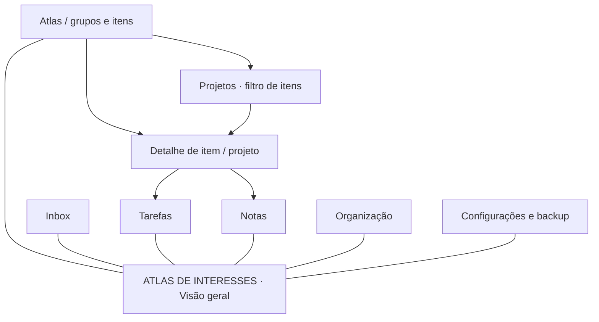

# UX e navegação da V1

**Estado:** especificação funcional consolidada; composição e atalhos PROPOSTOS para prototipagem. Nenhum wireframe interativo ou teste de usabilidade foi executado.

## 1. Mapa de navegação proposto

O hub conceitual mantém “ATLAS DE INTERESSES” no centro. Não é o canvas com zoom da V3 e não precisa ocupar toda tela interna. Uma sidebar operacional pode ser avaliada em protótipo, conforme recomendação aceita.

Sete telas principais são preservadas. Projetos é uma vista filtrada do Atlas; Configurações/Backup é área utilitária acessível globalmente. Q-08 confirma se a proprietária prefere uma área Projetos independente. O desenho acima é conceitual, não especificação de posicionamento pixel a pixel.

## 2. Telas e critérios

| Tela | Conteúdo | Ações essenciais | Vazio / falha |
| --- | --- | --- | --- |
| 1. Visão geral | Captura, próximas ações, prazos, projetos ativos, Inbox e recentes | Capturar, abrir registro, retomar trabalho | Convite para primeira captura; falha do vault visível |
| 2. Atlas | Grupos, itens e filtros locais | Criar item, abrir grupo, filtrar, mostrar Sem grupo | Grupo sem tags explicado; nenhum resultado não significa perda |
| 3. Detalhe | Título/tipo/status, tags, objetivo, datas, progresso e notas | Editar, arquivar, criar tarefa/nota contextual | Contexto inexistente diagnosticado; erro de escrita conserva edição |
| 4. Inbox | Pendentes, processadas e arquivadas | Capturar, escolher destino, processar, arquivar | Conversão pendente apresenta recuperação, sem falso sucesso |
| 5. Tarefas | Abertas, próximas, vencidas, por projeto e histórico | Criar, concluir/reabrir, definir prazo e projeto | Avulsas em Sem projeto; concluídas sob demanda |
| 6. Notas | Work/reading/permanent, editor, fontes, links e backlinks | Escrever, vincular, salvar, criar permanente | Link ausente sinalizado; conflito externo preserva versões |
| 7. Organização | Grupos/tags e uso de cada tag | Renomear, ordenar, editar, arquivar, associar | Prévia do impacto ao retirar tag; não excluir referenciados silenciosamente |

**Configurações/Backup:** localização do vault e versão do schema dos registros (derivada dos registros, possivelmente mista; D-014), preferências visuais, exportar/restaurar, diagnóstico. Restaurar abre escolha de pasta nova e resumo de verificação antes de ativar. *Atualização de 18/10/2026; redação anterior: “localização e versão do vault”. Não existe uma versão de schema própria do vault.*

**Restauração e exportação — DECIDIDO em 18/10/2026 (ordem e regras; DQ-16 a DQ-19).** O restante deste documento continua PROPOSTO. Textos, agrupamento visual, ordem dos botões e atalhos dependem de protótipo (Q-08). As regras normativas estão em [VAULT_CONTRACT §7.7](VAULT_CONTRACT.md).

1. Escolher o arquivo de backup.
2. Pré-leitura sem extrair, com resumo: data, versão do manifesto, número de arquivos, tamanho total e contagem por tipo.
3. Escolher a pasta-pai e o nome da nova pasta. O aplicativo verifica a sobreposição com o vault ativo por caminho real, mas ainda não cria a pasta (A-03, A-04).
4. Confirmar, com a frase “O vault atual não será alterado.” Só depois da confirmação e das pré-validações o aplicativo cria a pasta; cancelar antes disso não deixa pasta criada (A-03). *Redação anterior do passo 3: “O aplicativo cria a pasta e recusa sobreposição com o vault ativo.”*
5. Progresso cancelável; cancelar equivale a uma restauração interrompida.
6. Verificação.
7. Relatório: Verificado, Verificado com avisos, Falhou ou Interrompido (definições em [VAULT_CONTRACT §7.7](VAULT_CONTRACT.md) item 7).
8. Ações: “Abrir vault restaurado”, só nos estados verificados, com confirmação e aplicando antes o fluxo de alterações pendentes do §4, que continua PROPOSTO; “Mostrar pasta”; “Salvar relatório”, fora do vault restaurado; “Fechar”.

Exportação: inventário E-C (incluir, excluir ou cancelar; arquivos de sistema agrupados), confirmação, progresso, relatório. Registros inválidos e versões não suportadas aparecem como bloqueios a corrigir, sem opção de incluir (A-01). Durante a coleta, os editores ficam somente leitura.

## 3. Fluxos de referência

### Captura → projeto

Visão geral → capturar → Inbox → processar → escolher project → título/tags → tarefas opcionais → confirmar → resultado persistido → detalhe. Captura permanece disponível com referência ao resultado.

### Contexto → conhecimento permanente

Item → notas contextuais → abrir work/reading → Criar nota permanente a partir desta → elaborar conteúdo → salvar nova nota global com link para origem. Original permanece intacta. Reiniciar reconstrói o backlink pelo link no corpo.

### Um item em dois grupos

Organização → associar Tag UX a Design e Tecnologia → marcar Item com UX → abrir ambos os grupos. Os dois acessos apontam para o mesmo UUID/arquivo.

### Falha de salvamento

Editar → salvar → permissão recusada → mensagem específica + conteúdo ainda no editor → corrigir acesso/repetir ou exportar rascunho. Não mudar indicador para salvo e não descartar edição ao fechar sem escolha explícita.

## 4. Estados e ações

| Estado | Comportamento |
| --- | --- |
| Sem alterações | Indicador salvo corresponde à revisão persistida |
| Alterado | Indicar pendência e permitir salvar |
| Salvando | Evitar submissão duplicada da mesma operação |
| Erro | Mensagem acionável; conservar conteúdo e opção de repetir |
| Conflito externo | Comparar versões; não sobrescrever automaticamente |
| Recuperação Inbox | Bloquear conversão repetida; explicar progresso/diagnóstico |
| Arquivado | Identificar registro e oferecer recuperação conforme regras |

**Proposta de salvamento V1:** botão explícito e Ctrl/Cmd+S. Autosave pode ser avaliado depois de provar persistência e conflitos. Ao fechar com alterações: Salvar, Descartar com confirmação ou Cancelar fechamento. O evento nativo específico depende da stack e da prova GUI.

## 5. Atalhos propostos

| Ação | Atalho candidato |
| --- | --- |
| Visão geral | Alt+1 |
| Inbox | Alt+2 |
| Atlas | Alt+3 |
| Tarefas | Alt+4 |
| Notas | Alt+5 |
| Organização | Alt+6 |
| Salvar editor | Ctrl+S / Cmd+S |

A numeração de telas não determina o atalho; Inbox vem antes no fluxo de captura. Validar conflitos por sistema operacional e teclado antes de registrar atalhos globais. Todas as ações devem existir também por controles visíveis.

## 6. Layout, acessibilidade e validação

Usar [Design System](DESIGN_SYSTEM.md). Dar foco visível, rótulos, ordem lógica de tabulação, mensagens associadas aos campos e contraste medido por combinação real. Não usar apenas cor para tipo/status. Painéis contextuais são permitidos como proposta, com comportamento coerente em janela estreita.

Protótipos devem demonstrar as quatro jornadas acima com estados vazio, erro e conflito. Testar compreensão com a proprietária e registrar observações antes de fechar Q-08. Este documento não declara a UI aprovada ou pronta.
